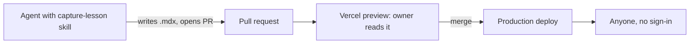

# Lessons web app (phase 1)

Status: ready for implementation.

Distillate becomes a web app that serves lessons and records. Namaq's lessons move here, the lessons already in this repo are restyled to match them, and the Electron app, the MCP server and cards are removed until phase 2. Terms are defined in [CONTEXT.md](../../CONTEXT.md); why lessons are code rather than data is [ADR 0001](../adr/0001-lessons-are-code-published-by-deploy.md). This plan supersedes [lesson-mcp-integration.md](lesson-mcp-integration.md), which is deleted in step 1.

## Agreed behavior and scope

- **Lessons** are MDX files under `content/lessons/<track>/<NNNN-slug>/index.mdx`, with frontmatter `title`, `number`, `summary`, `disclosure` (`open` or `generic`) and `sourceProject`. A lesson may import components from its own folder. A lesson whose page is mostly a visualization may be `page.tsx` instead of `index.mdx`, exporting the same metadata.
- **Records** are short MDX files under `content/records/<source-project>/<NNNN-slug>.mdx`, with frontmatter `title`, `disclosure`, `sourceProject` and an optional `lesson` naming the lesson it grew into.
- **Tracks** are folders under `content/lessons/`, each with a `track.mdx` holding its mission, plus optional `resources.mdx` and `notes.mdx`. Phase 1 has three tracks:
  - `text-to-evidence`: namaq's six lessons and its reference card, with namaq's MISSION, RESOURCES and NOTES;
  - `ai-agents`: lessons 1 to 7 on this repo's `main`;
  - `world-models`: lessons 8 to 11 on `main`, with the root `MISSION.md`, `RESOURCES.md` and `reference/world-models-cheat-sheet.md`.
- **Pages**: home (the tracks), a track page (mission, then lessons in order), a lesson page (the shared layout with an index, a theme switch, and previous/next within the track), a records page grouped by source project, and a record page.
- **Style**: namaq's lesson style, ported once into the shared layout and `mdx-components.tsx`: serif body, stone palette, amber accents, light and dark themes, a collapsible index. No lesson carries its own styling; plain Markdown elements get the look from the layout.
- **Shared components** to start: `Callout`, `Quiz`, `ArabicQuote` (right-to-left, `lang="ar"`), `Mermaid`, `RepoLink` (a link to a file in another repository on GitHub), `Stepper` (step-by-step reveal), and a `useReducedMotion` hook that animations use to show their final frame.
- **Everything is readable by anyone**, with no sign-in. There is no database, no API and no MCP server.

### Exclusions

- Cards, the card store, the MCP server, the `capture_card` tool and the Electron app. These are deleted; phase 2 rebuilds cards on a remote database with an API, tokens, MCP pointed at the API, and sign-in for review.
- Any way to add a lesson other than a pull request.
- Converting records into cards. That is a phase 2 question.

## Content migration

| From | To | Disclosure |
| --- | --- | --- |
| namaq `docs/lessons/lessons/0001`–`0006` | `content/lessons/text-to-evidence/0001`–`0006` | open |
| namaq `docs/lessons/reference/source-pipeline.html` | `content/lessons/text-to-evidence/reference.mdx` | open |
| namaq `docs/lessons/MISSION.md`, `RESOURCES.md`, `NOTES.md` | `content/lessons/text-to-evidence/track.mdx`, `resources.mdx`, `notes.mdx` | open |
| namaq `docs/lessons/learning-records/0001`–`0019` | `content/records/namaq/0001`–`0019` | open |
| `src/renderer/public/lessons/0001`–`0007` | `content/lessons/ai-agents/0001`–`0007` | open |
| `src/renderer/public/lessons/0008`–`0011` | `content/lessons/world-models/0001`–`0004` | open |
| root `MISSION.md`, `RESOURCES.md`, `reference/world-models-cheat-sheet.md` | `content/lessons/world-models/track.mdx`, `resources.mdx`, `reference.mdx` | open |
| root `learning-records/0001`, `0002` | `content/records/world-models/0001`, `0002` | open |

Conversion rules:

- Prose becomes Markdown. Quizzes, banners and callouts become components. Inline styles and Tailwind classes are dropped.
- The text of a lesson does not change in conversion, with these exceptions: lesson 5's heading shows a raw `$\to$`, which becomes `→`; lessons 9 and 10 (about 2 KB each) are expanded to the depth of lesson 8 or merged into it, whichever reads better, and the PR says which.
- Namaq's relative links to its own files (`../../src/...`, `../adr/...`, `../data-pipelines.md`) become `RepoLink`s to `github.com/msskzx/namaq` on `main`. A link between two lessons becomes a link between their new pages.
- Lesson 3 (`the-frontier-pause-wars`) and lesson 11 (`dream-rsi`) make factual claims and cite sources nobody has checked, among them arXiv 2609.14858. The converting agent checks every reference URL in those two lessons resolves to what it is cited for, and lists any that fail in the PR body rather than fixing the prose.

## Affected components

Order matters: step 2 needs the folder step 1 frees, and step 4 needs the layout from step 3.

1. **Remove the desktop app and cards** (verified paths): `src/main`, `src/preload`, `src/renderer` (after its lessons are copied out), `src/mcp`, `src/core`, `src/shared`, `tests/*`, `electron.vite.config.ts`, `tsconfig.node.json`, `tsconfig.web.json`, `build/`, `install/global-AGENTS.md`, `skill/distillate/`, `ARCHITECTURE.md`, `docs/plans/lesson-mcp-integration.md`. Drop Electron, electron-vite, electron-builder, `@modelcontextprotocol/server`, the SQLite adapters and their scripts from `package.json`.
2. **Scaffold the web app** (new paths): Next.js App Router with `@next/mdx`, Tailwind and the typography plugin, under `app/`, `components/`, `content/`, `mdx-components.tsx`, `next.config.ts`. Pin every dependency to an exact version; `main` uses `latest` today. Keep Bun as the package manager.
3. **Layout and shared components** (new): `components/lesson/` for the layout, index, theme switch and previous/next; `components/mdx/` for the components listed above; `lib/content.ts` to read frontmatter from `content/` at build time and build the track, lesson and record lists. Every page is statically generated.
4. **Convert content** per the migration table.
5. **Repoint `capture-lesson`**: `skill/capture-lesson/SKILL.md` (see Open issues) tells an agent to write a record or a lesson as MDX in this repository and open a pull request; to choose `open` only when the source project's repository is public and `generic` otherwise or when unsure; and how to write generically. Remove its instruction to also submit a card.
6. **Docs**: rewrite `README.md` for the web app; add `.claude/` to `.gitignore`.
7. **Namaq, a separate PR in that repository**, merged after this one is deployed: delete `docs/lessons/`; replace its mentions in `AGENTS.md` and `README.md` with the lessons site's URL; drop the "also submit a card" wording wherever namaq repeats it.

## Acceptance criteria

1. `bun run build` produces a static page for every lesson, record and track in the migration table, and fails if any MDX file has invalid frontmatter or names an unknown component.
2. Every lesson renders in the shared style in light and dark themes, with the index and previous/next working, and no lesson file contains a `class` or `className` attribute.
3. Namaq's lesson text survives conversion: for each of the six lessons, the visible text of the new page matches the visible text of the old HTML apart from whitespace, the chrome (index, theme button) and the link targets.
4. No link on any page points at a relative path from namaq. Every `RepoLink` resolves to a file that exists in namaq on `main`.
5. Lesson 5 shows no `$\to$`; lessons 9 and 10 are no longer stubs.
6. Arabic quotes render right-to-left.
7. The repository holds no Electron, MCP, SQLite or card code, and `package.json` has no `latest` versions.
8. `capture-lesson` describes the pull-request flow and the disclosure rule, and mentions no card.
9. Namaq has no `docs/lessons/`, and nothing in it links there.

## Validation

- **Content test** (`lib/content.test.ts`): every lesson and record has valid frontmatter; numbers within a track are unique and contiguous; every `lesson` field on a record names an existing lesson; disclosure is `open` or `generic`. Covers criteria 1 and 5.
- **Render test**: render every lesson to a string and assert it throws nothing and contains no `className` from the source; assert lesson 5 has no `$\to$`. Covers criteria 1, 2 and 5.
- **Text-parity script**, run once during conversion and its output pasted into the PR: strip tags from each old namaq HTML lesson and each new rendered page, normalise whitespace, diff. Covers criterion 3.
- **Link check**: collect every `RepoLink` path and confirm it exists in a namaq checkout. Covers criterion 4.
- **Visual check** in the browser: one namaq lesson, one ai-agents lesson and one record, each in light and dark, at desktop and phone width; one Arabic quote; the reduced-motion setting on a page with a `Stepper`. Covers criteria 2 and 6.
- Required before the PR: `bun run lint`, `bunx tsc --noEmit`, `bun test`, `bun run build`.

## Operational consequences

- The owner connects the repository to Vercel once (an account action an agent cannot take). Until then the app is verified locally with `bun run dev`. No environment variables or database are needed in phase 1.
- Namaq's PR (step 7) waits until the lessons site has a production URL to link to.
- The owner's global agent instructions may still carry the rule from `install/global-AGENTS.md` and an installed copy at `~/.claude/skills/distillate/`. Removing those is the owner's edit outside this repository; the PR body says so.

## Open issues

### Resolved

- **The skills that `~/.claude/skills` points at were not committed.** `capture-lesson`, `pr-cycle`, `review-brief`, `blind-test-brief` and `expand-contract-migration` existed only as untracked folders in the main checkout. The owner chose to commit them in this PR. After it merges, the main checkout must delete its untracked copies before pulling, or git refuses to overwrite them.

### Nonblocking assumptions

- Records are grouped by source project, not by track, since several namaq records (Node versions, graph physics, a subagent misreporting checks) belong to no one track.
- `RepoLink` targets namaq's `main`, not a pinned commit; a renamed file in namaq breaks the link, and the link check catches it on the next build.
- The `ai-agents` track has no mission file today. The converting agent drafts a two-sentence mission from its lessons' own introductions and the PR asks the owner to confirm it.
- World-models lessons are renumbered from 1 within their track.

### Deferred to phase 2

- Cards on a remote database, a create API with tokens, MCP pointed at it, and sign-in for review.
- Whether records become cards.
