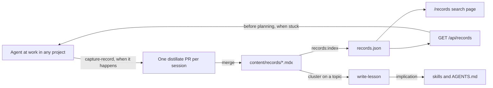

# Records engine

Status: ready for implementation once the owner confirms the open assumption below.

Records become the memory agents search before they design and when they are stuck, so that a challenge, obstacle or detour met in one project is not paid for again in another. The idea follows Dream-RSI's discovery trees (`content/lessons/world-models/0004-dream-rsi`), reduced to the part that pays off with little history: structured records, a search over them, and skills that write and read them. Terms are in [CONTEXT.md](../../CONTEXT.md); lessons stay as decided in [ADR 0001](../adr/0001-lessons-are-code-published-by-deploy.md).

Three layers, each for its own reader: records are cases for agents, lessons are understanding for the owner, skills are rules for every agent.

## Agreed behavior and scope

### A record

An MDX file at `content/records/<source-project>/NNNN-slug.mdx`. `meta` holds the fields and the body holds the story.

| Field | Required | Values |
| --- | --- | --- |
| `title` | yes | states the surprise or the problem |
| `kind` | yes | `challenge`, `obstacle`, `detour` |
| `problem` | yes | one sentence, phrased so the same problem in another project would match |
| `approach` | yes | what was tried |
| `outcome` | yes | `solved`, `failed`, `partial`, `open` |
| `conditions` | yes | what was true when it was tried (versions, data size, constraints) |
| `evidence` | yes | commit, PR, log line or file |
| `implication` | yes | the rule or skill to change, or `none` |
| `sourceProject`, `disclosure` | yes | as today |
| `date` | yes | ISO date the event happened |
| `summary` | yes | one sentence for listings, as today |
| `topics` | no | from the controlled list |
| `buildsOn`, `variantOf` | no | lists of record ids `<project>/<NNNN-slug>` |
| `lesson` | no | as today |

Every record, old or new, must have every required field. There is no legacy exception.

### Topics

A controlled list in `content/topics.json`, starting with: `evidence-model`, `source-extraction`, `text-matching`, `graph-layout`, `graph-ui`, `data-sync`, `migrations`, `testing`, `agent-review`, `build-tooling`, `runtime-versions`, `ui-rtl`. A topic is added by PR when a record needs one.

### Index, API and page

- `bun run records:index` writes `records.json` at the repo root from the record files: every field plus `id`, `href` and the absolute `url`. It is committed, and a test fails when it differs from what the script would write.
- `GET /api/records` reads the same index. Query parameters: `q` (text), `topic`, `kind`, `outcome`, `project`, each optional and combinable. It returns `{ records: [...] }` ranked best first, with `Access-Control-Allow-Origin: *`. With no parameters it returns every record, newest first.
- Ranking: lowercase word matching. A query word found in `problem` scores 3, in `approach`, `conditions` or `title` 2, in `topics` 2, elsewhere in the body 1. Records with no hit are left out when `q` is given.
- `/records` becomes the search page: a text box and filters for kind, outcome, topic and project over the same index in the browser, with the state in the URL (`?q=&topic=`). Each result row shows the problem, an outcome mark, the project and the date, and links to the record. The record page shows the structured fields above the story, with links to the records it builds on and is a variant of.

### Skills

- `capture-lesson` splits into:
  - `capture-record`: write a record at the moment a challenge, obstacle or detour happens, keeping the old `distillate` skill's filter (not routine work). It collects a session's records and opens one distillate PR per session. It holds the disclosure rule.
  - `write-lesson`: on request, or when a cluster of records on one topic is ready; written from the code as it is, naming the commit it describes.
- A search step: before proposing a design, query `/api/records` (or `records.json`) for the problem and its topics, and say what was found. Added to `pr-cycle`'s plan step in this repository. The owner's global grilling skills live outside the repository, so the PR body lists the line to add there.
- A when-stuck rule in `capture-record`: after the first fix fails, search before trying a second.

### Backfill

- The 21 existing work records gain every required field. The two `world-models` records were study notes, not work, so they move unchanged into the track as `content/lessons/world-models/notes/`.
- New records mined from namaq for three topics: evidence modelling, Quran text matching and graph exploration. Sources: the `docs/plans/` and ADRs for those areas, the Review sections of their PR bodies, and commit sequences where an approach was replaced. Detours are the priority, since the final code hides them.

### Exclusions

- The discovery-tree view, the manuscript UI and dreaming. They come after there is enough history.
- Embedding search. Revisit if text search misses variants that topics should have caught.
- A write API. Records arrive by PR.

## Acceptance criteria

1. Every file under `content/records/` has every required field with an allowed value; the build fails otherwise.
2. Every `topics` value is in `content/topics.json`, and every `buildsOn` or `variantOf` id names an existing record; the build fails otherwise.
3. `records.json` matches the record files exactly; a test fails when it is stale.
4. `GET /api/records?q=highlight` returns namaq record 0019 first; filters combine as an intersection; unknown filter values return an empty list, not an error.
5. `/records` filters and searches in the browser, keeps its state in the URL, and works in light and dark at phone width.
6. A record page shows its fields and links.
7. `capture-record` and `write-lesson` exist, `capture-lesson` is gone, and `pr-cycle`'s plan step includes the search.
8. The backfill adds records for the three topics, each with evidence that resolves to a real commit, PR or file in namaq.

## Affected components

Verified paths unless marked new.

1. `lib/content.ts`: extend `PageMeta` and `check` for the record fields, validate topics and links (criteria 1, 2).
2. `content/topics.json` (new); `scripts/records-index.ts` (new) and a `records:index` script in `package.json`; `records.json` (new) (criterion 3).
3. `app/api/records/route.ts` (new) and a ranking module `lib/search.ts` (new) shared by the route and the page (criterion 4).
4. `app/records/page.tsx` rewritten as the search page, with a client component for the filters; `app/records/[project]/[slug]/page.tsx` shows the fields (criteria 5, 6).
5. `skill/capture-lesson/` removed; `skill/capture-record/` and `skill/write-lesson/` (new); `skill/pr-cycle/SKILL.md` (criterion 7).
6. `content/records/**`: backfill (criterion 8).

### Delivery

Four PRs, each through `pr-cycle`, in this order:

1. Schema, validation, topics, index and its staleness test, and the 22 existing records brought up to the schema (1 must land before any other, since it makes the fields required).
2. API and search page.
3. Skills.
4. Namaq backfill for the three topics.

## Validation

- Content tests: a record missing each required field fails; an unknown topic fails; a dangling link fails; every real record passes (criteria 1, 2).
- Index test: regenerate in memory and compare with the committed file (criterion 3).
- Search tests in `lib/search.test.ts`, written blind from this plan: ranking weights, intersection of filters, empty results, the 0019 query (criterion 4).
- Route test: response shape, CORS header, parameters passed through.
- Page: a component test for filters and URL state; a browser check in light and dark at phone width (criterion 5).
- Checks before each PR: `bun run lint`, `bunx tsc --noEmit`, `bunx vitest run`, `bun run build`.

## Data and operational consequences

- The site at https://distillate-kappa.vercel.app deploys from `main`, so merging a record publishes it. Generic records must be generic before merge.
- Agents on any machine can query the deployed API; `records.json` on GitHub is the fallback when the site is down.

## Open issues

### Assumption for the owner to confirm (non-blocking)

- **A guard for generic records** (confirmed by the owner). A test that fails when a record with `disclosure: "generic"` contains a `RepoLink`, a file path or a URL to a repository. A generic record's project folder and `sourceProject` are a neutral name the agent chooses (`client-work`), never the real one, since both are published in the record's URL and in `records.json`; `capture-record` states this rule, and the guard cannot check a name it never sees. It cannot prove a record is generic, but it catches the commonest leaks before merge.

### Non-blocking

- The owner's uncommitted edits on the distillate `main` checkout (logo, track order, the extended lesson 6) are separate from this plan and need their own PR.
- The search step in the owner's global grilling skills is an edit outside this repository.
